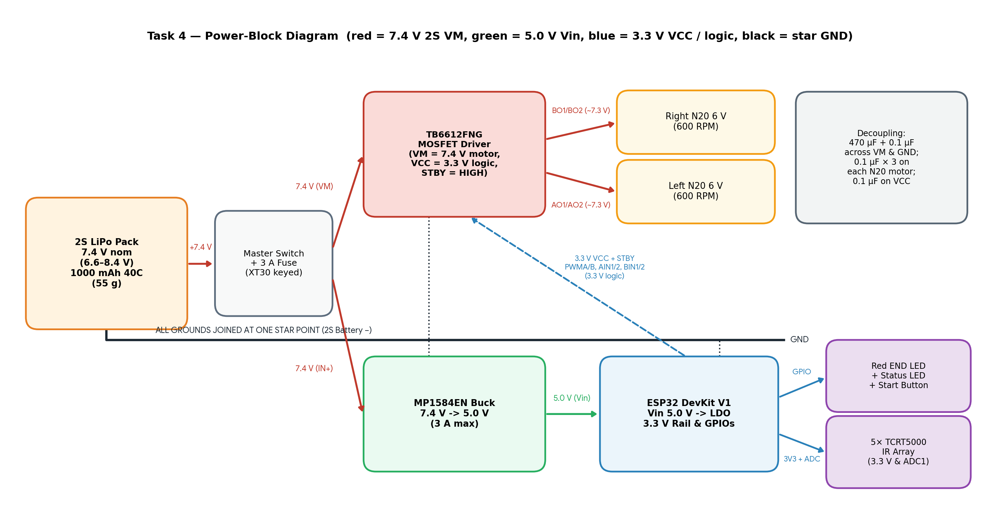

# Task 4 — Bill of Materials (Budget ₹10,000)

**Grand Total: ₹6,685 (including ₹250 shipping and 10% contingency) → ₹3,315 budget headroom.**

> **How to Read the Prices:** The *Price basis* column states the origin of each figure: *"robu page"* indicates direct verification on Robu.in; *"est."* indicates standard Indian robotics supplier pricing (Robu.in / ElectronicsComp)

---

## 1. Bill of Materials Table

| # | Category | Item / Exact Model | Qty | Unit ₹ | Line ₹ | Price Basis | Supplier | Link |
|--:|---|---|--:|--:|--:|---|---|---|
| 1 | Controller | ESP32 DevKit V1, 30-pin (ESP32-WROOM-32) | 1 | 450 | 450 | est. (seen ₹289–559) | Robu / Flyrobo | [search (confirm listing)](https://robu.in/?s=ESP32+DevKit+V1&post_type=product) |
| 2 | Motor driver | Toshiba TB6612FNG dual MOSFET H-bridge module | 1 | 180 | 180 | est. (seen ₹149–220) | Robu | [search (confirm listing)](https://robu.in/?s=TB6612FNG&post_type=product) |
| 3 | Motors | N20 6 V 600 RPM micro metal gear motor | 2 | 340 | 680 | est. | Robu | [search (confirm listing)](https://robu.in/?s=N20+6V+600+RPM&post_type=product) |
| 4 | Motor mounts | Mounting bracket for N20 motors (pack of 2) | 1 | 35 | 35 | robu page | Robu | [search (confirm listing)](https://robu.in/?s=N20+mounting+bracket&post_type=product) |
| 5 | Wheels | 44 mm 'miniQ' rubber tyre wheel for N20 | 2 | 67 | 134 | robu page (₹57–67) | Robu | [search (confirm listing)](https://robu.in/?s=miniQ+wheel+44mm+N20&post_type=product) |
| 6 | Caster | Metal ball caster (front support) | 1 | 60 | 60 | est. | Robu | [search (confirm listing)](https://robu.in/?s=ball+caster&post_type=product) |
| 7 | Battery | Orange 7.4 V 1000 mAh 40C 2S LiPo (55 g) | 1 | 750 | 750 | est. | Robu | [search (confirm listing)](https://robu.in/?s=7.4V+1000mAh+2S+LiPo&post_type=product) |
| 8 | Charger | iMAX B6-class balance charger (2S–6S) | 1 | 1,800 | 1,800 | est. (SkyRC B6AC V2 = ₹4017) | Robu | [search (confirm listing)](https://robu.in/?s=imax+b6+charger&post_type=product) |
| 9 | Battery safety | LiPo low-voltage alarm / cell checker (2S–8S) | 1 | 100 | 100 | est. | Robu | [search (confirm listing)](https://robu.in/?s=lipo+voltage+alarm&post_type=product) |
| 10 | Battery safety | LiPo battery strap, 30 cm | 1 | 53 | 53 | robu page | Robu | [search (confirm listing)](https://robu.in/?s=lipo+battery+strap&post_type=product) |
| 11 | 5 V supply | MP1584EN mini buck converter module (set to 5.0 V) | 1 | 80 | 80 | est. | Robu / ElectronicsComp | [search (confirm listing)](https://robu.in/?s=MP1584EN&post_type=product) |
| 12 | Sensors | TCRT5000 reflective IR sensor (bare), 5 + 2 spare | 7 | 18 | 126 | est. | Robu | [search (confirm listing)](https://robu.in/?s=TCRT5000&post_type=product) |
| 13 | Sensor board | Perfboard 3×7 cm + male header strip | 1 | 60 | 60 | est. | ElectronicsComp | [store home](https://www.electronicscomp.com/) |
| 14 | Passives | Resistor assortment (220 Ω, 10 kΩ, etc.) | 1 | 100 | 100 | est. | ElectronicsComp | [store home](https://www.electronicscomp.com/) |
| 15 | Passives | Electrolytic capacitor 470 µF / 25 V | 2 | 12 | 24 | est. | ElectronicsComp | [store home](https://www.electronicscomp.com/) |
| 16 | Passives | Ceramic capacitor 0.1 µF (104), pack of 10 | 1 | 20 | 20 | est. | ElectronicsComp | [store home](https://www.electronicscomp.com/) |
| 17 | Passives | 1N5819 Schottky diodes (protection), pack of 8 | 1 | 40 | 40 | est. | ElectronicsComp | [store home](https://www.electronicscomp.com/) |
| 18 | UI | Red 5 mm LED (END indicator) + status LED, pack of 5 | 1 | 20 | 20 | est. | ElectronicsComp | [store home](https://www.electronicscomp.com/) |
| 19 | UI | Tactile push-buttons (calibration / run select), pack of 5 | 1 | 25 | 25 | est. | ElectronicsComp | [store home](https://www.electronicscomp.com/) |
| 20 | Power | Slide / rocker power switch (single start switch) | 2 | 20 | 40 | est. | ElectronicsComp | [store home](https://www.electronicscomp.com/) |
| 21 | Power | 3 A fuse + inline holder | 1 | 40 | 40 | est. | ElectronicsComp | [store home](https://www.electronicscomp.com/) |
| 22 | Wiring | Silicone wire 22 AWG red + black, 2 m each | 1 | 120 | 120 | est. | Robu | [search (confirm listing)](https://robu.in/?s=silicone+wire+22awg&post_type=product) |
| 23 | Wiring | Dupont jumper set (M-F / F-F) | 1 | 130 | 130 | est. | Robu | [search (confirm listing)](https://robu.in/?s=dupont+jumper+wire&post_type=product) |
| 24 | Connectors | XT30 pair (robot side) + JST-XH 2S balance lead | 1 | 80 | 80 | est. | Robu | [search (confirm listing)](https://robu.in/?s=XT30+connector&post_type=product) |
| 25 | Connectors | Female header strips (ESP32 & TB6612FNG sockets) | 1 | 30 | 30 | est. | ElectronicsComp | [store home](https://www.electronicscomp.com/) |
| 26 | Chassis | Custom chassis: 3 mm acrylic laser-cut or PLA 3D print | 1 | 450 | 450 | est. | Local fab / Robu | [search (confirm listing)](https://robu.in/?s=acrylic+sheet+3mm&post_type=product) |
| 27 | Hardware | M3 screws, nuts, standoffs kit | 1 | 150 | 150 | est. | Robu | [search (confirm listing)](https://robu.in/?s=M3+standoff+kit&post_type=product) |
| 28 | Hardware | Heat-shrink, double-sided tape, cable ties | 1 | 50 | 50 | est. | Robu | [search (confirm listing)](https://robu.in/?s=heat+shrink+tube&post_type=product) |
| | | **Subtotal** | | | **5,827** | | | |
| | | Shipping (2 suppliers + LiPo handling) | | | 250 | | | |
| | | Contingency (10% of subtotal + shipping) | | | 608 | | | |
| | | **GRAND TOTAL** | | | **6,685** | | | |

---

## 2. Key Specifications and Rationale for Each Selection

| Component | Key Specifications | Selection Rationale |
|---|---|---|
| **ESP32 DevKit V1 (WROOM-32)** | 240 MHz dual-core Xtensa, 12-bit SAR ADC, 3.3 V logic, Vin 5 V | Mandated platform. Easily runs our deterministic 100 Hz (10 ms) PID & maze solver loop on Core 1 while leaving Core 0 free for BLE telemetry (Task 7). |
| **Toshiba TB6612FNG module** | Dual MOSFET H-bridge, $V_M = 2.5\text{–}13.5\text{ V}$, $V_{\text{CC}} = 2.7\text{–}5.5\text{ V}$, $1.2\text{ A}$ continuous / $3.2\text{ A}$ peak per channel, $R_{\text{DS(on)}} \approx 0.5\,\Omega$ | Drops only $\approx 0.1\text{ V}$ at running current ($0.2\text{ A}$) and $\approx 0.5\text{ V}$ at $1\text{ A}$ stall — saving $\sim 2.0\text{–}2.5\text{ V}$ wasted as heat in an L298N. Powered at $V_{\text{CC}} = 3.3\text{ V}$ so $V_{\text{IN(H)}} = 2.31\text{ V}$ matches ESP32 3.3 V GPIOs directly. |
| **2 × N20 6 V 600 RPM motors** | All-metal brass/steel gearbox, $10\times 12\text{ mm}$ cross-section, $3\text{ mm}$ D-shaft, $\sim 0.15\text{–}0.20\text{ A}$ running, $\le 0.9\text{–}1.0\text{ A}$ stall | Receives $\approx 7.3\text{ V}$ from the 2S LiPo after the TB6612FNG's $0.1\text{ V}$ drop; software PWM capping (`baseSpeed = 140`, `maxPwm = 220–255`) delivers crisp $\sim 600\text{ RPM}$  with $10\text{ g}$ mass per motor and stall safely below the driver's $1.2\text{ A}$ continuous rating. |
| **44 mm wheels + N20 brackets** | Soft rubber tyre, press-fit on $3\text{ mm}$ D-shaft | High traction on smooth white vinyl strips; zero axial slip and right ground clearance for the front sensor bar. |
| **Metal ball caster** | Omnidirectional steel ball support | Low-friction third contact point enabling zero-radius in-place pivot turns at $90^\circ$ maze junctions and dead ends. |
| **Orange 2S 1000 mAh 40C LiPo** | $7.4\text{ V}$ nominal ($6.6\text{–}8.4\text{ V}$), $55\text{ g}$, $40\text{C} = 40\text{ A}$ burst | $7.4\text{ V}$ nominal sits squarely inside the TB6612FNG's $2.5\text{–}13.5\text{ V}$ $V_M$ window, cuts battery mass by $30\text{ g}$ vs. a 3S pack, and delivers $\sim 104\text{ min}$ runtime (nearly $20\times$ a 5.5-minute Meshmerize match). |
| **Balance charger + alarm + strap** | 2S–6S cell balancing, $<3.3\text{ V/cell}$ buzzer | Prevents over-discharge ($<3.3\text{ V/cell}$) and cell imbalance during testing and competition heats. |
| **MP1584EN buck converter (5.0 V)** | $4.5\text{–}28\text{ V}$ input ($2\text{S } 6.6\text{–}8.4\text{ V}$ gives $\ge 1.6\text{ V}$ dropout margin), $3\text{ A}$ max, $>90\%$ efficiency | Since the TB6612FNG has no onboard 5 V regulator, the MP1584EN steps $7.4\text{ V}$ down to a clean, isolated $5.0\text{ V}$ rail for `ESP32 Vin` without linear-regulator heat. |
| **5 × TCRT5000 (+2 spare)** | $950\text{ nm}$ IR emitter + phototransistor, $3\text{–}5\text{ mm}$ optimal height | Mounted at $15\text{ mm}$ spacing across the $30\text{ mm}$ white line; powered from the clean $3.3\text{ V}$ rail so analog outputs never exceed the ESP32 ADC's $3.3\text{ V}$ limit. |
| **Passives & protection** | $470\,\mu\text{F}$ electrolytic, $0.1\,\mu\text{F}$ ceramics, $10\text{ k}\Omega$ pull-up/down, 3 A fuse | $470\,\mu\text{F} + 0.1\,\mu\text{F}$ across `VM`–`GND` suppresses motor switching spikes; three $0.1\,\mu\text{F}$ caps per motor quench brush arcing; $10\text{ k}\Omega$ resistor manages `STBY`. |
| **Custom chassis & hardware** | $3\text{ mm}$ laser-cut acrylic / 3D-printed PLA ($\sim 110\times 90\text{ mm}$), M3 standoffs | Complies with Meshmerize rules banning ready-made Lego/kit chassis, fits easily inside the $220\times 220\times 220\text{ mm}$ box, and sets exact $4\text{ mm}$ sensor clearance. |

---

## 3. Justification Over Alternatives (Motor Driver & Motor Selection)

### A. Motor Driver: **Toshiba TB6612FNG (Chosen for Tasks 1–8)** vs. **ST L298N** vs. **DRV8833**

| Criterion | **Toshiba TB6612FNG (Chosen)** | **ST L298N (Alternative / Appendix A)** | **TI DRV8833 (Alternative)** |
|---|---|---|---|
| **Output Stage & Voltage Drop ($1\text{ A}$)** | Low-$R_{\text{DS(on)}}$ MOSFET ($0.5\,\Omega$) $\rightarrow$ **$\approx 0.5\text{ V}$ drop** | Bipolar Darlington BJT $\rightarrow$ **$1.8\text{–}3.2\text{ V}$ drop** | MOSFET ($0.36\,\Omega$) $\rightarrow$ $\approx 0.36\text{ V}$ drop |
| **Heat Dissipated at $1\text{ A}$ Stall (2 ch)** | **$\approx 1.0\text{ W}$** (no heatsink needed) | **$\approx 5.0\text{ W}$** (requires heavy metal heatsink) | $\approx 0.72\text{ W}$ (no heatsink needed) |
| **Motor Supply ($V_M$) Range** | **$2.5\text{–}13.5\text{ V}$** ($15\text{ V}$ abs max) — ideal for **2S LiPo ($7.4\text{–}8.4\text{ V}$)** | Up to $46\text{ V}$ (needs $\ge 7\text{ V}$ when using onboard regulator) | $2.7\text{–}10.8\text{ V}$ (tighter ceiling on fresh 2S spikes) |
| **Footprint & Weight** | **$20\times 20\text{ mm}$, $\approx 2.5\text{ g}$** | $43\times 43\times 27\text{ mm}$, $\approx 26\text{ g}$ ($10\times$ heavier) | $18\times 21\text{ mm}$, $\approx 2\text{ g}$ |

**Why TB6612FNG Wins:** Compared to the L298N, the TB6612FNG eliminates up to $3.2\text{ V}$ of wasted Darlington saturation drop and $4\text{ W}$ of heat during stalls, shedding $23\text{ g}$ of driver weight and $30\text{ g}$ of battery weight (moving from a 3S to a 2S LiPo). Compared to the DRV8833, the TB6612FNG provides higher voltage headroom ($15\text{ V}$ vs. $10.8\text{ V}$) against inductive kickback on a fully charged $8.4\text{ V}$ 2S LiPo and separates speed (`PWMA`/`PWMB`) from direction (`AIN1/2`, `BIN1/2`), requiring only 2 hardware PWM channels instead of 4.

 
