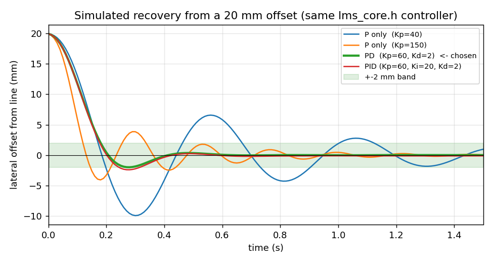

# Tasks 3 & 9 — PID Line Following and Tuning Notes


## 1. Role of Each PID Term in Line Following

Lateral error $e$ measures how far the line is from the sensor array centre in sensor-pitch units ($1\text{ unit} = 15\text{ mm}$, range $[-2, +2]$). The controller output $u$ is a **differential PWM speed correction** applied in opposite directions to the left and right wheels:

$$u(t) = K_p e(t) + K_i \int_0^t e(\tau)\,d\tau + K_d \frac{de(t)}{dt}$$

* **Proportional ($P = K_p \cdot e$):** Generates a steering correction directly proportional to the current lateral offset.
  * *Too low:* Sluggish response; the robot cuts $90^\circ$ corners or drifts off the 30 mm line.
  * *Too high:* Over-steering; the robot crosses the centreline with high lateral velocity and weaves back and forth ("hunting" / sustained oscillation).
* **Derivative ($D = K_d \cdot \frac{de}{dt}$):** Responds to the *rate of change* of the error. As the robot swings back toward the centre of the line ($e \to 0$), $\frac{de}{dt}$ has the opposite sign to $e$, producing a counter-steering braking torque *before* the robot crosses the line.
  * *Why D is essential here:* A differential-drive line follower is naturally a **double-integrator / under-damped plant** (wheel speed difference changes heading angle $\theta = \int \omega\,dt$, and heading angle integrates into lateral position $y = \int v \sin\theta\,dt$). Pure $P$ control on an integrating plant introduces phase lag that causes overshoot; $D$ adds phase lead and damps oscillation.
* **Integral ($I = K_i \int e\,dt$):** Accumulates past error over time to eliminate persistent **steady-state offset** (e.g., slight left/right motor asymmetry or a tilted floor).
  * *Why I is harmful on a maze track:* In a line-maze solver, the error changes sign every few hundred milliseconds at curves and junctions. An active integrator lags behind rapid direction changes, causing **integral windup** and severe overshoot exiting $90^\circ$ turns.

---

## 2. Selected Configuration: **PD Control** ($K_p = 60,\; K_d = 2.0,\; K_i = 0$)

We selected a **PD controller** (with filtered derivative and $K_i = 0$). Closed-loop simulation in `sim_tune.cpp` (20 mm initial lateral offset, `baseSpeed = 140` PWM, sensor noise $\pm 8$ ADC counts, fixed $10\text{ ms}$ loop period / $100\text{ Hz}$) confirms why PD outperforms both pure P and full PID:

| Controller Configuration | Gains ($K_p, K_i, K_d$) | Peak Overshoot | Settling Time (within $\pm 2\text{ mm}$) | Behavioural Assessment |
| :--- | :--- | :---: | :---: | :--- |
| **Pure P** | $K_p = 20 / 40 / 80 / 150$ | $62\% / 50\% / 34\% / 20\%$ | $2.28 / 1.12 / 0.73 / 0.44\text{ s}$ | Low $K_p$ wanders; high $K_p$ amplifies ADC noise and still overshoots without damping |
| **PD (Selected)** | **$K_p = 60,\; K_i = 0,\; K_d = 2.0$** | **$10\%$** | **$0.18\text{ s}$** | **Fastest settling, crisp damping, high noise immunity** |
| **PD (Aggressive)** | $K_p = 80,\; K_i = 0,\; K_d = 3.0$ | $1\%$ | $0.18\text{ s}$ | Slightly over-damped; higher $K_d$ increases high-frequency motor chatter |
| **Full PID** | $K_p = 60,\; K_i = 20 / 100,\; K_d = 2.0$ | $12\% / 20\%$ | $0.31 / 0.35\text{ s}$ | **Worse than PD** — integral accumulation adds phase lag and doubles settling time |



### Robustness & Hardware Scaling (TB6612FNG + 2S vs. Appendix A L298N + 3S)
* **Speed & Noise Sweep:** Across `baseSpeed` $= 100 / 140 / 180 / 220$ PWM, overshoot stays bounded at $3\% / 10\% / 16\% / 20\%$; under severe $\pm 60$-count ADC noise, overshoot remains $10\%$.
* **Actuator Response Advantage (Tasks 1–8):** With the **TB6612FNG + 2S LiPo (7.4 V)** and lightweight N20 motors, the mechanical time constant $\tau_m$ is small ($\le 40\text{–}60\text{ ms}$) and MOSFET switching has negligible deadband ($V_{\text{drop}} \approx 0.1\text{ V}$ running), so the derivative term acts cleanly without sluggish lag.

* **Code Flexibility:** The integral term remains implemented in `lms::Pid` with **output clamping (`iLimit = 30.0f`) and conditional anti-windup**, so a tiny $K_i$ can be enabled if hardware bench testing reveals a constant one-sided mechanical pull.

---

## 3. Pipeline: From Sensor Readings to Error to Motor Commands

1. **Raw Acquisition (`0..4095`):** Read the 5 analog IR channels (`S1..S5` on ESP32 ADC1 pins) via 12-bit `analogRead()`.
2. **Min-Max Calibration (`0..1000`):** During startup, each sensor records its empirical white/black extremes (`minRaw[i]`, `maxRaw[i]`) and normalizes readings to $[0, 1000]$:
   $$v_i = \text{clamp}_{[0, 1000]}\!\left(\frac{\text{raw}_i - \text{minRaw}_i}{\text{maxRaw}_i - \text{minRaw}_i} \times 1000\right)$$
   * For **Appendix A (Task 9)** (dark line = higher voltage), `lineIsHigh = true` keeps $v_i$ directly.
   * For **Meshmerize White-on-Black Arena (Tasks 1–8)** (if white line yields lower voltage), setting `lineIsHigh = false` inverts the reading ($1000 - v_i$) so the line is always represented by a **high positive value** ($v_i \to 1000$).
3. **Weighted Centroid & Error ($e \in [-2, +2]$):** Using sensor weights $w = [-2, -1, 0, +1, +2]$:
   $$\text{position} = \frac{\sum_{i=0}^{4} w_i v_i}{\sum_{i=0}^{4} v_i}, \qquad e = \text{position} - \underbrace{0.0}_{\text{setpoint}} = \text{position}$$
   * $e < 0$: Line is to the **left** of centre.
   * $e = 0$: Line is **perfectly centred** under `S3`.
   * $e > 0$: Line is to the **right** of centre.
   * If $\sum v_i < \text{minTotal}$ ($200$), `c.valid = false` triggers the lost-line state machine instead of dividing by near-zero noise.
4. **Filtered PD / PID Calculation:** Executed on a deterministic **$10\text{ ms}$ non-blocking timer** (`micros()`, no `delay()`), ensuring constant $dt = 0.01\text{ s}$:
   * First-sample derivative kick is suppressed (`first` flag).
   * Raw derivative $d = (e - e_{\text{prev}}) / dt$ passes through a first-order low-pass filter ($d_{\text{filt}} \mathrel{+}= \alpha (d - d_{\text{filt}})$, $\alpha = 0.5$) to reject ADC quantization spikes.
   * Output $u$ is saturated to $\pm\text{outLimit}$ ($\pm 110$ PWM counts).
5. **Differential Steering Mixing & Clamping:**
   $$\text{Left}_{\text{PWM}} = \text{clamp}_{[-255, +255]}(\text{baseSpeed} + u), \qquad \text{Right}_{\text{PWM}} = \text{clamp}_{[-255, +255]}(\text{baseSpeed} - u)$$
   * *Sign check:* When the line is on the **right** ($e > 0 \implies u > 0$), `left` speeds up ($	ext{base} + u$) and `right` slows down ($	ext{base} - u$), pivoting the robot **clockwise (right)** back onto the line.

### C++ Control Sketch (from `lms_core.h`)
```cpp
// Task 3 - simple PD line follower (5 sensors, readings 0..1000, higher = line)
// Arduino/ESP32: paste the two functions into your sketch.  On a PC: g++ task3_simple_pid.cpp && ./a.out
#ifndef ARDUINO
#include <cstdio>
#define constrain(x, a, b) ((x) < (a) ? (a) : ((x) > (b) ? (b) : (x)))
#endif

float Kp = 60, Ki = 0, Kd = 2;     // tuning: raise Kp until it wobbles, back off, then add Kd
int   baseSpeed = 140;             // PWM 0..255 when driving straight
float lastError = 0, integral = 0;

// Function 1: sensor readings -> error  (-2 far left ... 0 centred ... +2 far right)
float getError(const int s[5]) {
  const int w[5] = {-2, -1, 0, 1, 2};
  long num = 0, sum = 0;
  for (int i = 0; i < 5; i++) { num += (long)w[i] * s[i]; sum += s[i]; }
  if (sum == 0) return lastError;          // line lost: keep steering toward where it was last seen
  return (float)num / sum;
}

// Function 2: error -> left/right motor speeds (call this at a fixed rate, e.g. every 10 ms)
void pidControl(float error, int &left, int &right) {
  integral += error;
  float correction = Kp * error + Ki * integral + Kd * (error - lastError);
  lastError = error;
  left  = constrain(baseSpeed + (int)correction, -255, 255);   // line on the right -> left wheel faster
  right = constrain(baseSpeed - (int)correction, -255, 255);
}

#ifndef ARDUINO
int main() {                                // demo with hard-coded sensor readings
  int frames[3][5] = {{0, 0, 1000, 0, 0}, {0, 0, 200, 800, 0}, {0, 0, 0, 300, 900}};
  for (auto &f : frames) {
    int L, R; float e = getError(f); pidControl(e, L, R);
    printf("error %+.2f -> left %3d right %3d\n", e, L, R);
  }
}
#endif
```

---

## 4. Responding to Oscillation and Lost-Line Conditions

### A. Diagnosing and Fixing Oscillation
| Observed Symptom on Track | Root Cause | Corrective Tuning Action |
| :--- | :--- | :--- |
| **Steady left-right weaving ("hunting") on straightaways** | $K_p$ too high or $K_d$ too low (insufficient phase lead) | Decrease $K_p$ by **~20%** and/or increase $K_d$ in steps of $0.5$ until weaving stops after 1–2 swings. |
| **Sluggish drift off curves / wide corner cutting** | $K_p$ too low or `outLimit` too restrictive | Increase $K_p$ until brisk correction is achieved; ensure `outLimit` allows sufficient wheel speed differential. |
| **High-frequency motor buzz / twitching on straight line** | $K_d$ too high or raw ADC noise amplified by $de/dt$ | Lower $K_d$ or increase derivative filtering (reduce `dAlpha` from $0.5$ to $0.25$); shield IR sensors from ambient light. |
| **Overshoot only when entering tight $90^\circ$ turns at speed** | Forward inertia exceeds tyre traction at current `baseSpeed` | Lower `baseSpeed` slightly or increase $K_d$ to brake earlier into corners. |

**Systematic Tuning Procedure:** Set $K_i = 0, K_d = 0$. Increase $K_p$ from $20$ until the robot follows the line with slight continuous oscillation ($K_u$), back off $K_p$ by ~25–30% (to $60$), then raise $K_d$ until step disturbances damp out in a single swing ($K_d = 2.0$). Leave $K_i = 0$.

### B. Lost-Line Handling (5-State Machine in `lms_core.h`)
When all five sensors read background ($\sum v_i < 	ext{minTotal} = 200$), returning $e = 0$ would trick the controller into driving straight ahead off the track. Instead, `LineFollower::step()` transitions through:
1. **`GRACE_HOLD` ($\le 30	ext{ ms}$):** Holds the last valid motor commands (`lastL_`, `lastR_`). Small surface bumps or tape gaps briefly lift the sensor array for 1–3 ticks ($10	ext{–}30	ext{ ms}$); riding through prevents false recovery spins.
2. **`RECOVER_LEFT` / `RECOVER_RIGHT` ($30	ext{ ms} < t_{	ext{lost}} \le 500	ext{ ms}$):** Checks the sign of `lastPos_` (which edge sensor saw the line last) and commands an **in-place pivot** (`left = +pivotSpeed, right = -pivotSpeed` for right recovery, or `-110 / +110` for left recovery), clamped to `maxPwm`.
3. **`STOPPED` ($t_{	ext{lost}} > 500	ext{ ms}$):** If the line is not found within $500	ext{ ms}$, both motors are forced to `0 / 0` (putting the TB6612FNG/L298N into safe stop) and the `STOPPED` state is latched until `reset()` is called. This prevents a runaway robot and protects the motor driver from continuous stall heating.


