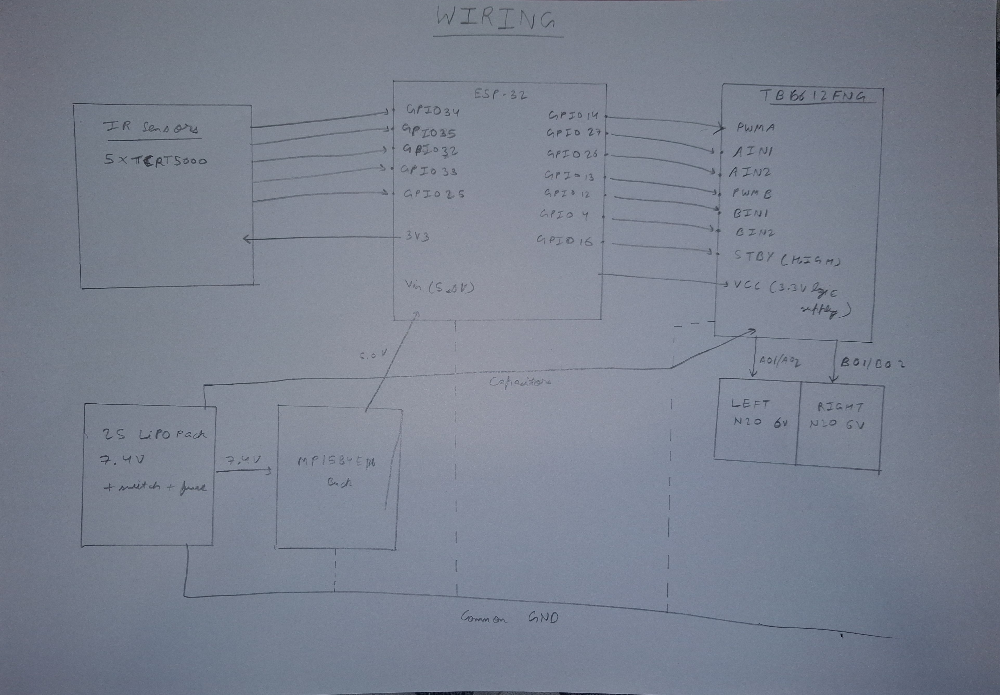

# Task 6 — Electronics & hardware

Diagram: `docs/img/wiring.jpg`  

## Supply voltages and grounding
| Rail | Source | Feeds | Note |
|---|---|---|---|
| **7.4 V nominal (6.6–8.4 V)** | 2S LiPo (1000 mAh 40C) via master switch + 3 A fuse | TB6612FNG `VM` (motor supply), MP1584EN buck input (`IN+`) | 470 µF electrolytic + 0.1 µF ceramic across `VM` and `GND` right at the TB6612FNG pins |
| **5.0 V** | MP1584EN switching buck | ESP32 `Vin` (feeds onboard 3.3 V LDO) | High-efficiency (>88 %) step-down; isolates motor current transients from MCU input |
| **3.3 V** | ESP32 on-board LDO (`3V3` pin) | TB6612FNG logic supply (`VCC`), `STBY` pull-up, 5× TCRT5000 IR array, END/status LEDs | ≈54 mA total logic/sensor draw; powering TB6612FNG `VCC` at 3.3 V sets $V_{\text{IN(H)}} = 0.7 \times 3.3\text{ V} = 2.31\text{ V}$ so 3.3 V ESP32 GPIOs are 100 % spec-compliant |

**Common ground (star topology):** battery negative (`2S LiPo −`) is the single reference point. TB6612FNG `GND`, MP1584EN buck `GND`, ESP32 `GND` and the sensor bar `GND` all meet at this star point; the **high-current motor return runs straight back from the TB6612FNG `GND` to the battery**. Without a common ground, the 3.3 V logic signals (`PWMA/B`, `AIN1/2`, `BIN1/2`, `STBY`) have no voltage reference at the TB6612FNG inputs and motor behavior becomes erratic; with a *shared thin* ground path, motor return current ($I \times R_{\text{wire}}$) creates ground bounce that corrupts the ESP32's 12-bit ADC sensor readings.

**Role of the motor driver (TB6612FNG):** it acts as a **high-current MOSFET power amplifier and bidirectional H-bridge switch**, bridging low-power 3.3 V MCU logic and the 7.4 V motor rail. Each channel is a full MOSFET H-bridge ($R_{\text{DS(on)}} \approx 0.5\,\Omega$ total):
* Direction pins (`AIN1`/`AIN2` for Left, `BIN1`/`BIN2` for Right) select which MOSFET pair conducts: forward (`1/0`), reverse (`0/1`), short brake (`1/1`), or coast/stop (`0/0`).
* Speed pins (`PWMA`, `PWMB`) modulate the active MOSFETs with **hardware PWM** so average motor voltage — and wheel speed — tracks duty cycle (`0..255`).
* The **`STBY` (Standby) pin** must be pulled `HIGH` (via `GPIO16` or a $10\text{ k}\Omega$ resistor to `3V3`) to enable the bridges; pulling `STBY` `LOW` forces all outputs into high-impedance sleep.
* The bridge delivers up to 1.2 A continuous (3.2 A peak) per channel from the 7.4 V 2S rail — current that an ESP32 GPIO pin (≈12–40 mA max) could never source directly.

**Hardware pin-mapping notes (fixing Appendix A / ESP32 hardware traps):**
1. **`GPIO11` SPI Flash Conflict:** Appendix A maps right motor direction B (`IN4` / `BIN2`) to `GPIO11`. On the ESP32-WROOM-32, `GPIO6–GPIO11` are wired internally to the SPI flash chip; driving `GPIO11` as an output crashes the CPU with an illegal instruction / watchdog panic. Our wiring remaps `BIN2` (`IN4`) to **`GPIO4`** in Task 6 (and provides a configurable macro in Task 9).
2. **`GPIO25` ADC2 vs. ADC1:** Appendix A labels `GPIO25` (`IR_S5`) as `ADC1_CH8`. On the ESP32, `ADC1` only has 8 channels (`CH0–CH7`), and `GPIO25` is actually **`ADC2_CH8`**. Because the ESP32 Wi-Fi driver locks the `ADC2` peripheral, Task 7 wireless diagnostics uses **BLE** (which leaves `ADC2` / `GPIO25` working normally, or allows `S5` to be moved to `GPIO36`/`GPIO39` on `ADC1`).
3. **`GPIO12` Boot Strapping Pin:** `GPIO12` (`BIN1` / `IN3`) is the ESP32 `MTDI` strapping pin, which selects flash voltage (`3.3 V` if `LOW` at boot, `1.8 V` if `HIGH` at boot). The TB6612FNG has internal $200\text{ k}\Omega$ pull-down resistors on all logic inputs (`AIN1/2`, `BIN1/2`, `PWMA/B`, `STBY`), naturally keeping `GPIO12` `LOW` during reset so the ESP32 boots reliably.

**Noise suppression:** three 0.1 µF ceramic capacitors soldered directly to each N20 motor (one across the terminals, one from each terminal to the metal motor casing), twisted motor leads, a 470 µF electrolytic + 0.1 µF ceramic across `VM`–`GND` at the TB6612FNG, a 0.1 µF bypass cap across `VCC`–`GND`, and physical separation between motor power leads and analog sensor wires.

## Troubleshooting analysis: *the ESP32 resets when the motors engage*
**Symptom:** the robot powers up and calibrates, then reboots (the Serial startup banner reprints) the instant the motors accelerate, reverse direction at a dead end, or hit a bump.

**Probable root causes (most to least likely):**
1. **Supply sag / brown-out:** dual N20 motor inrush (up to ≈1.0 A per motor at start or direction reversal) pulls the shared 2S battery or buck-input voltage down; if the MP1584EN input drops near its dropout threshold or lacks bulk capacitance, the 5.0 V `Vin` and 3.3 V rail dip below the ESP32 hardware brown-out threshold (~2.43 V on `3V3`).
2. **Ground bounce:** motor return current (~2 A peak) flows through a shared thin jumper wire or breadboard strip, lifting the ESP32's local `GND` potential by hundreds of millivolts relative to battery negative.
3. **Inductive brush transients** coupling into the 5 V / 3.3 V rails (missing 0.1 µF motor caps, missing `VM` bulk capacitor, or motor leads bundled alongside ESP32 wires).
4. **Weak / discharged 2S LiPo or high-resistance connector** (discharged below 3.3 V/cell, loose XT30/JST plug, or oxidized switch contacts).
5. **Software / pin-conflict reset masquerading as a motor reset:** driving `GPIO11` (internal SPI flash pin) when commanding the right motor backward (`BIN2` / `IN4` active), or an external pull-up holding `GPIO12` (`MTDI`) `HIGH` during a reset.

**First diagnostic check (cheap, decisive):** print the hardware reset reason at the top of `setup()` — `Serial.println(esp_reset_reason());` — and distinguish **`ESP_RST_BROWNOUT`** (power rail sag) from **`ESP_RST_PANIC` / `ESP_RST_WDT`** (software crash or `GPIO11` SPI flash conflict when right motor direction B triggers). Simultaneously, while commanding a motor start/reverse, probe **`ESP32 Vin` (5.0 V) and `3V3` with an oscilloscope in single-shot falling-edge trigger (or a multimeter in fast Min/Max capture mode)**, referenced directly to the ESP32's own `GND` pin. A dip below ≈4.5 V on `Vin` (or below ≈3.0 V on `3V3`) at motor engagement proves supply sag; high-frequency ringing spikes point to brush EMI; a rock-steady rail with `ESP_RST_PANIC` proves a pin/firmware fault.

**Fix (in this order) and confirmation:**
1. Verify/solder the **470 µF bulk electrolytic + 0.1 µF ceramic** directly across `VM` and `GND` on the TB6612FNG, add **100–220 µF + 0.1 µF** across `ESP32 Vin`–`GND`, and verify the three **0.1 µF ceramic caps** on each N20 motor.
2. Re-wire ground as a true **star topology** at the 2S battery negative terminal using 22 AWG silicone wire and a solid XT30 connector (never route motor current through a solderless breadboard).
3. Add a firmware **slew-rate / soft-start limiter** (ramping PWM duty over ~30–50 ms on abrupt reversals) so peak inrush current is reduced.
4. Confirm the 2S LiPo is charged and balanced (>3.7 V/cell under load) and that `BIN2` is wired to `GPIO4` (not `GPIO11`).
**Confirm:** execute 50 consecutive full-speed forward-to-reverse motor cycles and a physical bump test with Serial logging enabled — **zero resets**, `esp_reset_reason()` remains `ESP_RST_POWERON`, and oscilloscope captures confirm `Vin` stays ≥ 4.8 V and `3V3` stays ≥ 3.25 V throughout every transient.
