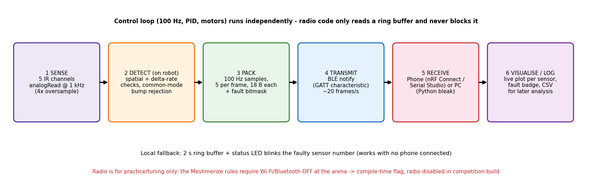

# Task 7 — Wireless sensor diagnostics (intermittent IR readings on a bumpy surface)

## 1. Protocol: **BLE** (notifications over a custom GATT characteristic)
| Feature | Wi-Fi (UDP / WebSocket) | Classic Bluetooth (SPP) | **BLE (Chosen)** |
|---|---|---|---|
| **Latency** | Low (~5–20 ms), but suffers retries/jitter on crowded 2.4 GHz channels | Low (~10–20 ms) | **7.5–15 ms connection interval** (~20–30 ms end-to-end) — fast enough for real-time live plotting |
| **Power draw** | ≈150–250 mA continuous (increases our **403 mA** typical 2S budget by **~40–60 %**) | High (~60–100 mA continuous) | **≈15–30 mA in brief bursts** (<5 % impact on the 2S battery budget) |
| **ESP32 ADC impact** | **Disables `ADC2` hardware peripheral — and `IR_S5` is wired to `GPIO25` (`ADC2_CH8`)**, so Sensor 5 fails (`analogRead` error / garbage) *the moment Wi-Fi starts!* | Uses shared 2.4 GHz radio; heavier stack overhead | **Lightweight radio bursts; leaves `ADC1` (`S1..S4`) untouched** (and allows clean time-division or remapping `S5` to `GPIO36`/`ADC1_CH0`) |
| **Phone / PC support** | Needs an external router or AP mode; phone drops cellular data when joined | Android / Windows only (**blocked on iOS** without MFi chip) | **Native on Android, iOS (nRF Connect / LightBlue), Web Bluetooth browsers, and Python (`bleak`)** |
| **Ease of setup** | Moderate (IP discovery / socket handling) | Easy (`BluetoothSerial.h`) | **Simple with `NimBLE-Arduino` / ESP32 BLE** (1 service + 1 notify characteristic) |

**Why BLE is the best choice:**
1. **Low data rate fits BLE perfectly:** 5 sensors × 2 bytes × 100 Hz = **1.0 kB/s** (about 1.8 kB/s with timestamps and fault flags), well inside BLE 4.2/5.0 notification throughput (~15–50 kB/s with negotiated MTU).
2. **Power efficiency on a 2S LiPo:** Keeps the ESP32's 3.3 V LDO cool and prevents current spikes on the 5 V buck rail.
3. **No router needed at the track:** Connects directly from the robot to any phone or laptop browser via Web Bluetooth.

---

## 2. System architecture & fault-detection logic (stage by stage)

1. **Stage 1 — Oversampled ADC acquisition (on ESP32 Core 1, 1 kHz):**
   * Inside the 100 Hz (10 ms) PID control loop, a hardware timer samples all 5 IR channels (`S1..S5`) at **1 kHz** (1 ms sub-ticks) with 4× hardware oversampling to reject high-frequency MOSFET PWM switching noise from the TB6612FNG.
2. **Stage 2 — On-robot physics & spatial-continuity fault detector (1 kHz):**
   * Streaming raw 1 kHz data over radio wastes bandwidth, and a human looking at a 20 Hz phone plot cannot tell a real line edge from a 2 ms loose-wire dropout. Therefore, the **ESP32 detects faults in real time at 1 kHz** using four simple physical rules (at ~1.0 m/s robot speed, the 30 mm line takes ~15 ms to cross a 15 mm sensor pitch, so a real reading cannot jump full-scale in 1 ms):
   * **Rule A — Single-channel spike (`Delta-rate` test):** If $|v_i(t) - v_i(t-1)| > 1200$ ADC counts in 1 ms on sensor $i$ while its immediate neighbours ($i-1, i+1$) change by $< 200$ counts, it is flagged as an **intermittent contact glitch** (a real line crossing smoothly sweeps adjacent sensors).
   * **Rule B — Rail-sticking / open-wire dropout (`Rail-bound` test):** If raw ADC reading drops to $< 15$ (open ground / broken emitter) or saturates at $> 4080$ (shorted pull-up / loose signal pin) for 1–5 ms while neighbours remain within normal calibrated bounds `[minRaw, maxRaw]`.
   * **Rule C — Common-mode bump filter (prevents false alarms):** When the robot hits a physical bump on the maze floor, the entire front sensor bar lifts by 1–3 mm for ~10–20 ms, causing **3 or more sensors to drop or rise together** in the same direction. If $\ge 3$ channels jump simultaneously, the firmware flags a `SURFACE_BUMP` bit and **does not blame any individual sensor**.
   * **Rule D — Sliding-window fault counter:** Each channel maintains a glitch counter over a rolling 200 ms window. If `glitch_count[i] >= 3`, bit `i` in `fault_mask` (`0b00001` to `0b10000`) is latched `HIGH`, identifying the exact faulty sensor(s) (`S1..S5`).
3. **Stage 3 — Lock-free ring buffer & packet framing (Core 1 $\to$ Core 0):**
   * Each 10 ms PID tick pushes an **18-byte diagnostic struct** into a lock-free FreeRTOS ring buffer in RAM:
     `[seq: 2B] [t_ms: 4B] [raw S1..S5: 10B] [fault_mask: 1B] [flags (bump/lost-line/state): 1B]`.
   * A low-priority task pinned to **Core 0** packs 5 samples into a **90-byte BLE frame** every 50 ms (**20 Hz notification rate**). Because Core 1 never waits for the radio, the 100 Hz PID loop has **zero timing jitter**.
4. **Stage 4 — BLE GATT transmission:**
   * Transmitted via non-blocking BLE `notify()` (MTU negotiated to $\ge 185$ bytes).
5. **Stage 5 — Receiver & live dashboard (Phone / PC):**
   * A Web Bluetooth page (or **Serial Studio** / Python `bleak` logger) unpacks the 90-byte frames, plots the 5 sensor traces at 100 Hz effective time resolution, highlights any sensor whose `fault_mask` bit is set in **bright red** (e.g., `"FAULT DETECTED: IR_S2 — intermittent open circuit on bumps"`), marks surface bumps in yellow, and saves a CSV log.
6. **Hardware-free fallback:** Even without a screen, the onboard status LED (`GPIO2`) blinks the faulty sensor index ($1\text{ to }5\text{ flashes}$) so the operator knows which sensor to re-solder immediately after the run.
