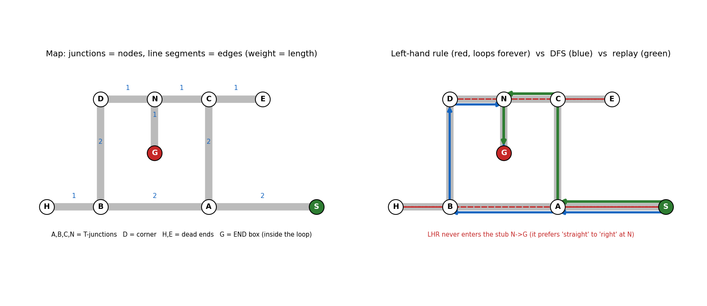

# Task 8 — Maze-solving algorithms

Diagram: `docs/img/maze_example.png`.



## 1. Comparison: Wall-preference (Left/Right-Hand Rule) vs. DFS (Graph Search)
| Feature | Left / Right-Hand Rule (Wall Follower) | **DFS on a Junction Graph (Chosen)** |
|---|---|---|
| **Memory & sensing required** | Minimal: stores only a flat array of turns (`L, S, R, B`); needs only basic junction detection | Stores a **graph map** in RAM: node coordinates/IDs, connected edges, edge lengths, and a `visited` table |
| **Completeness guarantee** | Guaranteed to find `END` **only if the maze is simply connected** (a pure tree with no closed loops or isolated islands) | **Always finds `END`** in any finite connected maze (even with loops) because the `visited` set prevents infinite cycling |
| **Behaviour on closed loops** | **Gets trapped in an infinite loop** if `END` is inside an island or if the wall rule circles an outer loop | Detects already-visited junctions, backtracks cleanly, and explores every reachable branch |
| **Replay route quality** | Algebraic turn reduction (`X+B+Y`) removes dead-end stubs, **but cannot remove loops** (takes a longer path) | Full graph map allows **Dijkstra / BFS** to compute the **true global shortest path** for the Actual Run |

**Decision for an unknown Meshmerize maze: DFS on a junction graph.**  
A pure Left-Hand or Right-Hand rule can cycle forever around a loop or miss the shortest route if there are loops in maze. Using **DFS with a `visited` set** guarantees reaching the $400\times 400\text{ mm}$ white `END` box during the 3-minute Dry Run, and building a junction graph lets us run **Dijkstra's algorithm** to guarantee the fastest route for the 2.5-minute Actual Run.

---

## 2. How Junctions and Paths Map to Nodes and Edges
In our example maze (`maze_example.png` and `maze_demo.py`), every decision point or terminal is a **Graph Node ($V$)** and every straight white-line segment between two nodes is a **Weighted Undirected Edge ($E$)**:
* **Start & End Nodes:** **`S`** $(5,0)$ is the `START` point; **`G`** $(2,1)$ is the $400\times 400\text{ mm}$ `END` box located **inside** a closed loop.
* **Junctions & Corners:** **`A`** $(3,0)$, **`B`** $(1,0)$, **`C`** $(3,2)$, and **`N`** $(2,2)$ are 3-way T-junctions; **`D`** $(1,2)$ is a $90\text{°}$ corner node.
* **Dead Ends (Leaf Nodes):** **`H`** $(0,0)$ and **`E`** $(4,2)$ are dead-end stubs (degree 1).
* **Loop Structure & Edge Weights:** The cycle **`A — B — D — N — C — A`** forms a closed loop of perimeter $8$ units around the goal stub **`N — G`**. Each edge weight equals its Manhattan segment length (e.g., $w(S,A)=2$, $w(A,B)=2$, $w(A,C)=2$, $w(B,H)=1$, $w(B,D)=2$, $w(D,N)=1$, $w(N,C)=1$, $w(N,G)=1$, $w(C,E)=1$).

---

## 3. Worked Traversal Example (Reproduced by `maze_demo.py`)

### A. Why the Simple Left-Hand Rule Fails on This Maze (Priority: `L > S > R > B`)
Starting at `S` heading West into `A`:
1. **`S -> A`** (heading West): options are Straight (`B`) or Right (`C`). Picks **Straight (`S`)** $\to$ **`B`**.
2. **`B`** (heading West): options are Straight (`H`) or Right (`D`). Picks **Straight (`S`)** $\to$ **`H`** (dead end).
3. **`H`** (dead end): executes U-turn (**`B`**) $\to$ returns to **`B`** (now heading East).
4. **`B`** (heading East): options are Left (`D`) or Straight (`A`). Picks **Left (`L`)** $\to$ **`D`**.
5. **`D`** (heading North): corner only has Right (`N`). Picks **Right (`R`)** $\to$ **`N`**.
6. **`N`** (heading East): options are Straight (`C`, East) or Right (`G`, South — the `END` box!). Because Left-Hand priority prefers **Straight (`S`) over Right (`R`)**, it ignores `G` and drives straight to **`C`**!
7. **`C -> E -> C -> A -> S -> A -> B ...`**: From `C` it visits dead end `E`, turns Right down `C -> A`, goes to `S`, bounces back, and **circles the outer loop forever without ever entering `G`** (red dashed path in diagram).

### B. How Our Chosen DFS Explores and Solves the Maze (Priority: `L > S > R` among *unvisited* neighbours)
DFS uses the same `L > S > R` preference for *unvisited* branches, but **never enters an already-visited node**; when all branches at a node are visited, it backtracks along the `path_stack`:
1. **`S -> A`** (mark `S, A` visited; stack: `[S, A]`).
2. **At `A` (West):** unvisited are `B` (`S`) and `C` (`R`). Picks **`S` $\to$ `B`** (stack: `[S, A, B]`).
3. **At `B` (West):** unvisited are `H` (`S`) and `D` (`R`). Picks **`S` $\to$ `H`** (stack: `[S, A, B, H]`).
4. **At `H` (dead end):** no unvisited neighbours $\implies$ pops `H`, turns Back (**`B`**) $\to$ **`B`** (stack: `[S, A, B]`).
5. **At `B` (East):** `D` (`L`) is unvisited (`A` is already visited). Picks **`L` $\to$ `D`** (stack: `[S, A, B, D]`).
6. **At `D` (North):** picks **`R` $\to$ `N`** (stack: `[S, A, B, D, N]`).
7. **At `N` (East):** unvisited are `C` (`S`) and `G` (`R`). Picks **`S` $\to$ `C`** (stack: `[S, A, B, D, N, C]`).
8. **At `C` (East):** `E` (`S`) is unvisited (`A` is already visited!). Picks **`S` $\to$ `E`** (stack: `[S, A, B, D, N, C, E]`).
9. **At `E` (dead end):** pops `E`, turns Back (**`B`**) $\to$ **`C`** (stack: `[S, A, B, D, N, C]`).
10. **At `C` (West):** neighbor `A` (`L`) is *already visited*, and `N` (`S`) is *already visited*! Because no unvisited branch exists at `C`, DFS **backtracks** to parent **`N`** via **`S`** (stack: `[S, A, B, D, N]`).
11. **At `N` (West):** unvisited neighbour `G` is to the Left (`L`). Picks **`L` $\to$ `G` (`END` reached! Red LED ON)**.

* **Raw turn sequence recorded:** `S S B L R S S B S L`
* **DFS stack route:** `S -> A -> B -> D -> N -> G` (total distance = **8 units**).

### C. Turn Reduction vs. Dijkstra Optimal Replay
* **Algebraic Turn Reduction (`X + B + Y` angle addition: $S=0\text{°}, R=90\text{°}, B=180\text{°}, L=270\text{°}$):**
  
  $$\text{SS(BLR)SS(BSL)} \xrightarrow{\text{BLR} \to \text{B},\; \text{BSL} \to \text{R}} \text{SS(BSB)L} \xrightarrow{\text{SB}\text{S} \text{ or } \text{SBL} \to \text{R}} \mathbf{S R R R}$$
  *(Step-by-step: `SBL -> R` gives `SRRSSBSL`; then `SBS -> B` gives `SRRBL`; then `RBL -> B` or left-to-right `SBL -> R`, `SBS -> B`, `SBL -> R` yields **`SRRR`**).*  
  Turn reduction eliminates dead ends `H` and `E`, yielding path `S -> A -> B -> D -> N -> G` (**length 8**), **but fails to notice the shortcut `A -> C -> N` because it does not understand loop geometry!**
* **Graph Shortest Path (Dijkstra on learned map):**
  Because our robot also records the edge `(C, A)` when sensing the junction at `C`, running **Dijkstra's algorithm** from `S` to `G` on the discovered edges finds:
  $$\mathbf{S \to A \to C \to N \to G} \quad (\text{Total cost} = \mathbf{6\text{ units}}, \text{ turns at } A, C, N = \mathbf{R, L, L})$$
  This saves **25 % of the travel distance** (6 units vs. 8 units) and eliminates two $90\text{°}$ turns, winning the 30-point *Shortest Path* bonus in Meshmerize.

---

## 4. Exploratory Traversal (Dry Run) vs. Optimal-Route Replay (Actual Run)
| Phase | Goal | Speed & Control Strategy | Why Replay Can Use a Much Simpler Strategy |
|---|---|---|---|
| **1. Exploratory Traversal (Dry Run, $\le 3\text{ min}$)** | Discover unknown maze topology and reach `END` | Moderate cruising speed (`baseSpeed = 140`); must slow down at every junction, step forward ~15 mm to classify T/Cross/Corner vs. END box, check `visited` table, and perform $180\text{°}$ U-turns at dead ends. | Must handle uncertainty, dead ends, and loop detection in real time. |
| **2. Optimal-Route Replay (Actual Run, $\le 2.5\text{ min}$)** | Sprint from `START` to `END` along the pre-computed shortest path in minimum time | High straight-line speed (`baseSpeed = 180–220` on the TB6612FNG + 2S LiPo); pre-brakes before known turns and executes `turns[i++]` (`R, L, L`) immediately without stopping to classify branches. | **Zero search overhead:** every dead end and loop has already been pruned by Dijkstra. The robot simply follows the line, counts junctions ($i = 0, 1, 2\dots$), and executes `turns[i]`. |

---

## 5. Pseudocode (DFS Exploration + Dijkstra Optimal Replay)

```text
START
  start = node at (0,0)
  stack = [start]                      # remembers the way back
  end_nodes = []                       # END boxes are kept here, separately

PHASE 1: EXPLORE (depth-first search)
  repeat:
    drive along the line to the next node (junction, corner, dead end or END box)
    measure the distance driven and which exits exist (left / straight / right)

    new position = old position + distance (in the current heading)
    if a known node is near that position:  node = that node
    else:                                   node = new node, push it on the stack
    save the edge (previous node <-> node) with its length

    if node is the END box:  add it to end_nodes and carry on exploring

    if we reached a known node by a NEW edge (a loop):
        U-turn and go straight back          # every edge is driven only twice
    else if node has an unexplored exit:
        take the first one in the order LEFT, STRAIGHT, RIGHT
    else:                                    # dead end, or everything here is done
        pop the node from the stack
        if the stack is empty:  stop         # back at (0,0), whole maze mapped
        turn toward the parent node (the new top of the stack)

PHASE 2: SHORTEST PATH
  run Dijkstra on the saved graph (edge weight = length)
      from (0,0) to the nearest node in end_nodes
  walk along that path and write one letter per node:  L, S or R
      example result:  "LSRLSSRL"

PHASE 3: REPLAY
  for each letter in the string:
      drive to the next node
      turn as the letter says
  at the END box: stop and switch the red LED on
```
